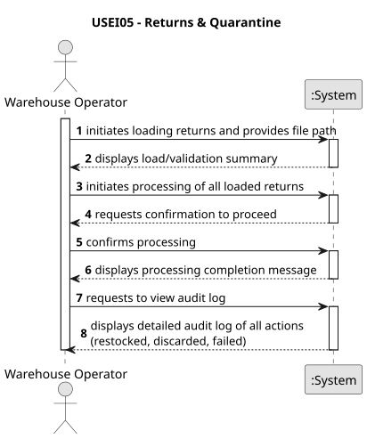

# USEI05 – Returns & Quarantine

## 1. Requirements Engineering

### 1.1. User Story Description

As a **quality operator**, I want **returned goods** to be placed in **quarantine** so that I can **inspect them in reverse order (latest first)**, decide whether to **restock** or **discard** each item, and create an **audit log file** detailing all processing actions.

### 1.2. Customer Specifications and Clarifications

**From the specifications document:**

> **Context:**  
> In a warehouse, returned products cannot immediately re-enter inventory. They must first be placed into **quarantine** to ensure quality and safety.  
> This step prevents damaged or expired goods from being mixed with usable stock.  
> Quarantined items are inspected in the **reverse order they arrived** (latest first, ties by `returnId ASC`), because these are usually the most urgent to process.  
> After inspection, items may either be **discarded** (unsuitable) or **restocked** (safe).  
> Every inspection must be written to a **log file** containing the relevant details.

> **Reasons for returns:**
> - Customer remorse → Item still good → *Restock*
> - Damaged → Unusable → *Discard*
> - Expired → Past expiry → *Discard*
> - Cycle count → Mismatch found → *Restock*

> **Audit Log Example:**
> ```
> 2025-09-22 14:32 | returnId=R105 | sku=SKU123 | action=Restocked | qty=8
> 2025-09-22 14:40 | returnId=R106 | sku=SKU200 | action=Discarded
> ```

**From client clarifications:**
> - “Restocked” products must be inserted as **new boxes** with ID `"RET-" + returnId` into the warehouse according to the **FEFO/FIFO insertion rules** defined in USEI01.
> - Discarded products are not stored again; they only appear in the audit log.
> - Each processed return (restocked or discarded) must generate a **single line** in the log file.
> - Timestamp ordering is **descending**, then by `returnId ASC` (for deterministic order).

---

### 1.3. Acceptance Criteria

| ID | Acceptance Criterion |
|----|----------------------|
| **AC1** | All returns are first loaded and validated (no invalid SKUs, dates, or quantities). |
| **AC2** | Returns are processed **in reverse chronological order** (latest first, ties by `returnId ASC`). |
| **AC3** | Each return is **classified** by its reason: `customer-remorse` and `cycle-count` → *Restock*; `damaged` and `expired` → *Discard*. |
| **AC4** | **Restocked** items are inserted as new boxes (`boxId="RET-" + returnId`) into the appropriate bay using FEFO/FIFO rules. |
| **AC5** | **Discarded** items are not reinserted into inventory. |
| **AC6** | Each inspection generates one line in an external **audit log file** containing timestamp, returnId, SKU, action, and qty. |
| **AC7** | System continues processing even if some returns are invalid (log error and skip). |

---

### 1.4. Found-out Dependencies

| Dependency | Description |
|-------------|--------------|
| **USEI01** | FEFO/FIFO storage logic for inserting new boxes (restocked items). |
| **ImportLogger** | For deterministic reporting of errors and skipped lines during CSV parsing. |
| **WarehouseManager** | Used to insert new boxes into the warehouse structure. |
| **Items Catalog** | Needed to validate SKUs in returns.csv. |

---

### 1.5. Input and Output Data

#### **Input Data**
- **File:** `returns.csv`  
  | Column | Type | Description |
  |----------|--------|--------------|
  | `returnId` | String | Unique return ID |
  | `sku` | String | Product SKU |
  | `qty` | Integer | Quantity returned |
  | `reason` | Enum | One of {customer-remorse, damaged, expired, cycle-count} |
  | `timestamp` | ISO8601 datetime | When the return arrived |
  | `expiryDate` | ISO8601 date or empty | Expiry date (optional) |

- **Existing Data:**
    - Warehouse inventory (from USEI01)
    - Items catalog (from `items.csv`)

#### **Output Data**
- **Updated Warehouse Inventory:**  
  Restocked items inserted according to FEFO/FIFO rules.
- **Audit Log File:**  
  `Logs/audit_log.txt` – one line per processed return.

Example:
2025-09-22 14:32 | returnId=RET00003 | sku=SKU0003 | action=Restocked | qty=17
2025-09-22 14:40 | returnId=RET00002 | sku=SKU0008 | action=Discarded | qty=18


---

### 1.6. System Sequence Diagram (SSD)



---

### 1.7. Other Relevant Remarks

- The inspection process must be **deterministic**: the same `returns.csv` input always yields the same processing order and log output.
- This feature reuses existing warehouse logic, so **no direct access** to CSV or in-memory structures bypassing the `WarehouseManager` is allowed.
- The log file acts as an **immutable audit trail**, ensuring accountability for each inspection.
