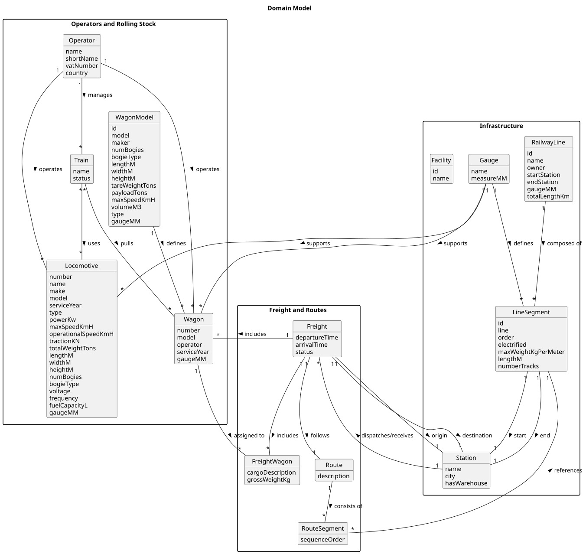

# OO Analysis

The construction of the domain model is based on the client specifications, extracting nouns (for _concepts_) and verbs (for _relations_).

---

## Rationale to Identify Domain Conceptual Classes

To identify domain conceptual classes, candidate conceptual classes were listed inspired by the categories suggested by Larman in *"Applying UML and Patterns: An Introduction to Object-Oriented Analysis and Design and Iterative Development"*.

---

### _Conceptual Class Category List_

**Business Transactions**
- Freight
- Route
- RouteSegment

**Transaction Line Items**
- Locomotive
- Wagon
- FreightWagon

**Product/Service related to a Transaction or Transaction Line Item**
- Train
- Freight Service
- Route

**Transaction Records**
- Freight (records a transport operation)

**Roles of People or Organizations**
- Operator

**Places**
- Station
- RailwayLine
- LineSegment
- Facility

**Noteworthy Events**
- Freight dispatching
- Freight arrival
- Route execution

**Physical Objects**
- Train
- Locomotive
- Wagon
- WagonModel
- LineSegment
- RailwayLine
- Station

**Descriptions of Things**
- WagonModel (technical characteristics of wagons)
- Gauge (track and gauge description)
- Locomotive (technical specifications)

**Catalogs**
- WagonModel
- Gauge types

**Containers**
- RailwayLine (contains LineSegments)
- Route (contains RouteSegments)

**Elements of Containers**
- LineSegment
- RouteSegment
- Wagon

**Organizations**
- Operator

**Other External/Collaborating Systems**
- N/A

**Records of Finance, Work, Contracts, Legal Matters**
- N/A

**Documents mentioned/used to perform some work**
- Possibly derived from Freight or Route, but not directly represented

---

## Rationale to Identify Associations Between Conceptual Classes

Associations were identified based on semantic relations observed between classes, according to common association patterns:
- *A* is part of *B*
- *A* is contained in *B*
- *A* is described by *B*
- *A* uses or operates *B*
- *A* is related to the transaction of *B*

---

| Concept (A) | Association | Concept (B) |
|--------------|-------------|-------------|
| Operator | operates | Locomotive  |
| Operator | operates | Wagon       |
| Operator | manages | Train       |
| Train | uses | Locomotive  |
| Train | pulls | Wagon       |
| WagonModel | defines | Wagon       |
| RailwayLine | composed of | LineSegment |
| LineSegment | start | Station     |
| LineSegment | end | Station     |
| Gauge | defines | LineSegment |
| Gauge | supports | Locomotive  |
| Gauge | supports | Wagon       |
| Freight | includes | Wagon       |
| Freight | includes | FreightWagon |
| Freight | follows | Route       |
| Freight | origin | Station     |
| Freight | destination | Station     |
| Wagon | assigned to | FreightWagon |
| Route | consists of | RouteSegment |
| RouteSegment | references | LineSegment |
| Station | dispatches/receives | Freight     |

---

## Domain Model Diagram

