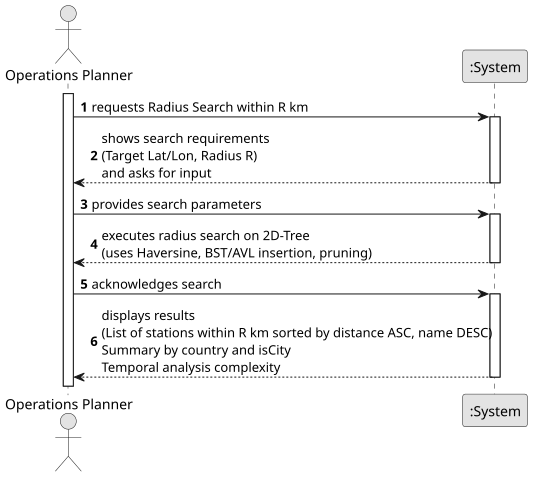

# USEI10-Radius search and density summary

## 1. Requirements Engineering

### 1.1. User Story Description

### 1.2. Customer Specifications and Clarifications

**From the client clarifications (Forum):**

### 1.3. Acceptance Criteria

### 1.4. Found out Dependencies

### 1.5 Input and Output Data

**Output Data:**

### 1.6. System Sequence Diagram (SSD)

### 1.7 Other Relevant Remarks

